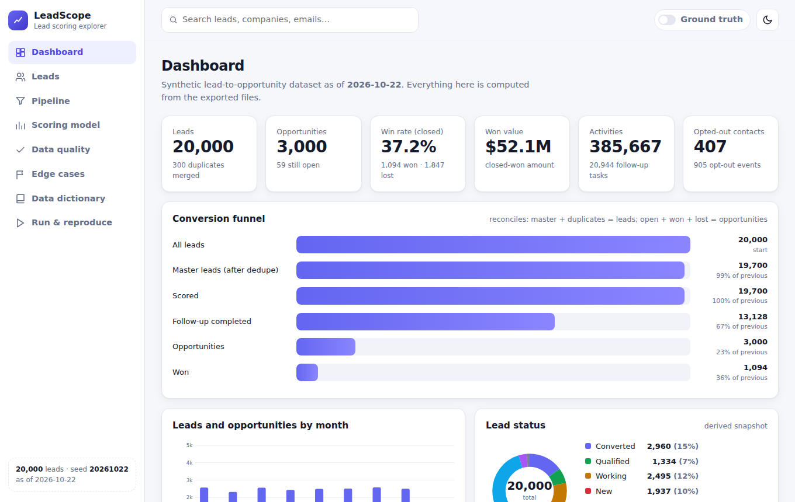
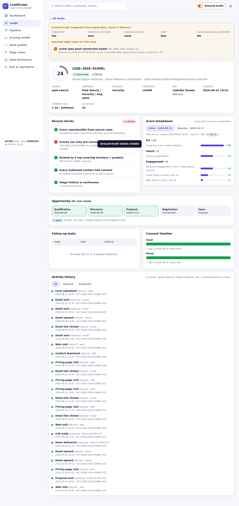

# Lead Scoring, Follow-up & Opportunity Tracking: synthetic data generator

Deterministic, **standard-library-only** (Python 3.10+) generator that builds a relational dataset for the workflow
*score leads from fit, intent and engagement, assign follow-ups, track progression to opportunity outcomes*, together with a
separate ground truth, an independent validator, a held-out evaluation, and reproducibility proof.

## Quick start
```bash   
python -m leadgen serve --open                    # web UI on the committed starter dataset: nothing to generate first
python -m leadgen generate --out output/full      # 20,000 leads / 10,000 contacts / 5,000 companies / 3,000 opps (~40 s)
python -m leadgen serve --dir output/full --open   # explore the full dataset
python -m leadgen generate --scale 0.05 --out data/starter   # same generator, starter volumes (~1 s)
python -m leadgen validate --dir output/full
python -m leadgen evaluate --dir output/full
python -m leadgen repro --scale 1.0               # generate twice, same seed, compare row counts + SHA-256
pip install -r requirements-dev.txt && python -m pytest -q   # 73 tests (~30 s); browser tests need `playwright install chromium`, else they skip
```
Options: `--seed` (default 20261022), `--scale`, `--leads/--contacts/--companies/--opportunities`, `--formats csv,json,sql`.
Reproducibility is guaranteed for the same Python minor version (checksums were produced on 3.12). The generator, validator, evaluator and web UI use **only the Python standard library**.

## Web UI: LeadScope
`python -m leadgen serve` starts a local, read-only app (`http://127.0.0.1:8000`) over any generated dataset. Plain HTML/CSS/JS, no build step, no CDN, works offline.

| Page | What it shows |
|---|---|
| Dashboard | KPIs, reconciling conversion funnel, monthly volume, status mix, tiers, conversion by source/territory |
| Leads | Search, filters, sorting, pagination; open any lead for a full audit trail |
| Lead detail | Score ring, **traceable score breakdown** (every point links to a `ScoreRule`), live **record checks** (score reproducible, pre-conversion data only, routing, consent, stage continuity), activity timeline, consent timeline, tasks, opportunity stepper |
| Pipeline | Opportunities by stage with value; filters |
| Scoring model | Held-out AUC/lift, decile + tier calibration, leakage guard, the versioned rules |
| Data quality | Validation verdict, detectors vs ground truth, every invariant (filterable), **re-run validation** button |
| Edge cases | The 7 labelled exception types, each with how it is detected, linked to the affected lead |
| Data dictionary | All 14 tables, columns, FKs, rules, cardinality |
| Run & reproduce | Seed, config, commands, manifest with checksums |

The **Ground truth** switch (top right) reveals labels from `ground_truth/` (hidden blockers, injected edge cases). They are off by default and the API only returns them on request, mirroring the rule that ground truth never leaks into features. Light/dark theme, keyboard navigable (skip link, focus rings, ARIA), responsive down to phone width.




API (read-only JSON): `/api/overview`, `/api/leads?q=&tier=&status=&page=`, `/api/leads/<id>`, `/api/opportunities`, `/api/validation`, `/api/evaluation`, `/api/anomalies`, `/api/dictionary`, `/api/meta`; `POST /api/revalidate`. Binds to localhost by default; path traversal is blocked and every dynamic value is HTML-escaped.

## Output layout (`output/full/`)
| path | content |
|---|---|
| `csv/ json/ sql/seed.sql` | 14 tables (SQL has DDL with PK/FK/CHECK; load with `sqlite3 db < sql/seed.sql`) |
| `ground_truth/anomalies.csv` | every injected edge case: `issue_type`, `record_id`, related IDs, description |
| `ground_truth/lead_labels.csv` | per-lead outcome labels, hidden blocker, holdout split. **Never an input feature** |
| `schema/` | `schema.sql`, `data_dictionary.md/json` (also `docs/DATA_DICTIONARY.md`) |
| `validation_summary.md/json`, `evaluation_report.md/json` | results |
| `MANIFEST.json`, `run_metadata.json`, `SOURCE_MANIFEST.md` | checksums+row counts, seed/config/command, provenance |

## Model of the problem
Entities (PK/FK, cardinality, lifecycles in the data dictionary): Company, Contact, Lead, Campaign, Activity, Consent, ScoreRule,
SalesRep, Task, Opportunity, StageHistory, plus bridge/event tables `RepCoverage` (rep N:M territory x product),
`LeadScore` (append-only score events) and `LeadScoreComponent` (Lead/Score N:M ScoreRule: explains every point).

Generation order: campaigns → companies/contacts/leads (IDs assigned in `created_at` order) → consent timelines → dedupe →
reps/routing → activities, **point-in-time scoring**, tasks → outcome model → post-window activity → labelled anomalies → derived values.

Key design decisions (details in `docs/DESIGN.md`):
* **Transparent score**: 23 effective-dated rules (fit / intent / engagement) in `ScoreRule`; v2 supersedes v1 on 2026-06-01. The initial score is taken 14 days after lead creation using only activities up to that moment.
* **Outcomes come from a documented rule, not coin flips**: conversion = top-N of a hidden logit (different weights than the score, plus hidden blockers and rep responsiveness) with Gumbel noise; win/loss, stage path, and win/loss reasons follow explicit rules. So the score is informative but imperfect and *high-score non-converters* arise naturally.
* **Consent is enforced in the baseline**: outbound activity/tasks require an `opt_in` period at that instant; missing consent → task cancelled (`no_consent`/`opted_out`) or phone→email fallback.
* **Derived values are computed, not drawn**: band, territory, scores, tiers, task/opportunity/campaign/lead status, `current_stage`, `closed_at`.
* **Validator is independent** of the generator: reads only the CSVs, re-derives dedupe, scores, statuses and consent from source rows.

## Labelled edge cases (all counted in `ground_truth/anomalies.csv`)
`opted_out_lead_contacted`, `score_uses_post_conversion_event` (a late `rescore` row; evaluation must use `trigger='initial'`),
`lead_assigned_outside_territory`, `duplicate_creates_duplicate_opportunity`, `stage_history_gap`, plus injected `duplicate_contact`/`duplicate_lead`.
Baseline rows are never silently corrupted: detectors must find **exactly** the labelled set (precision = recall = 1), otherwise validation fails.

## Results at the default seed (full run)
* Validation: 97/97 invariants pass, 7/7 anomaly detectors equal ground truth (`docs/VALIDATION_FULL_RUN.md`).
* Held-out (temporal) evaluation: AUC ≈ 0.73, top-decile lift ≈ 2.8x; tier A converts ~3-5x tier D (`docs/EVALUATION_FULL_RUN.md`).
* Reproducibility: two full runs identical (`docs/REPRODUCIBILITY_FULL_RUN.txt`).
* **73 tests**: unit, dataset, brief-compliance (one per requirement, also runnable on the full dataset via `make audit-full`), API/HTTP, and 24 real-browser end-to-end tests. Includes **mutation tests** (corrupt an FK, PK, score, consent, enum, date → validator must fail) so checks are not vacuous, and a test that the UI's per-record checks find exactly the ground-truth leads.
* Requirement-by-requirement evidence: `docs/REQUIREMENTS_TRACEABILITY.md`.

## Limitations (honest)
Activity/response rates, amounts and reason mixes are plausible but not calibrated to a real company. Conversion is fully observed by the
as-of date (no right-censoring), a simplification. Lead `status` is a derived snapshot that encodes outcomes: not a model feature. Names are
random combinations of common given/family names with fictional `.example` domains; no external data is used (`SOURCE_MANIFEST.md`).

## Layout
```
leadgen/   generator.py  scoring.py  logic.py  schema.py  validate.py  evaluate.py  export.py  store.py  server.py  cli.py
           web/ (index.html styles.css app.js)
tests/     unit, dataset, brief compliance, API, browser E2E
data/starter/  committed small dataset (scale 0.05)      docs/  design, dictionary, evidence, screenshots
```

## LLM usage
See `AI_USAGE.md` and `PROMPT_LOG.md` (required by the submission guidelines; **complete them with your own account before submitting**).
